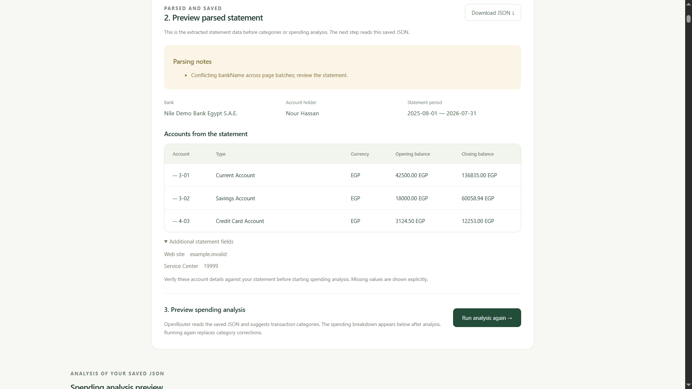
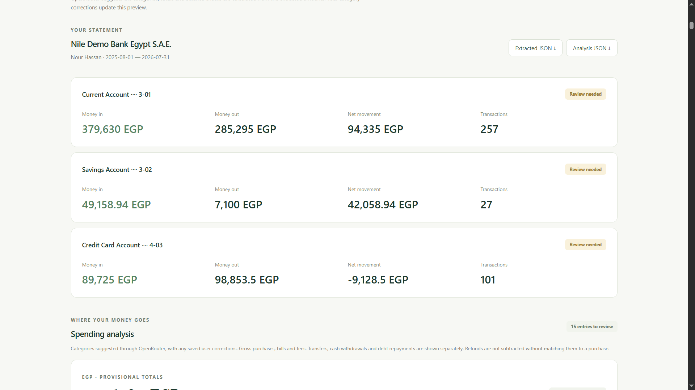
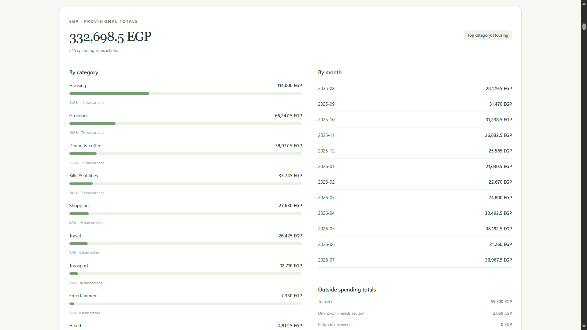
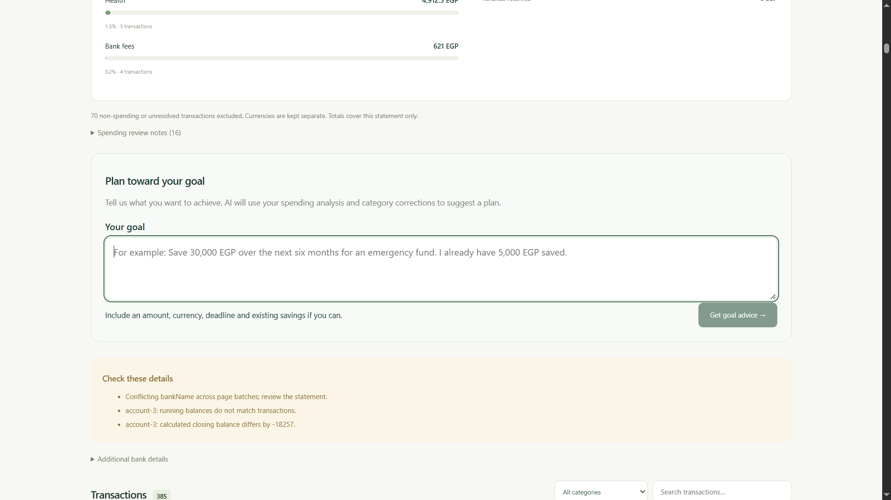
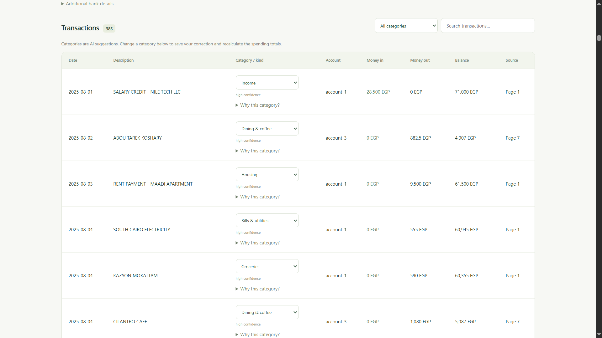

# Statement Studio

An npm workspace monorepo with an Express API, a single React page using TanStack Query, and shared Zod types. Upload and parse a PDF into JSON in small page batches, review it, then run a separate JSON-only AI spending analysis using AI SDK and OpenRouter.

Requires Node.js 22.13 or newer (Node 24 recommended).

## App preview

### Parsed statement

Review extracted account details and parsing notes before starting spending analysis.



### Account summaries

See money in, money out, net movement, transaction counts, and balance review status for each account.



### Spending breakdown

Explore spending by category and month, with transfers and unresolved entries shown separately.



### Goal advice

Enter a financial goal to request budgeting suggestions based on the saved spending analysis.



### Transaction review

Review extracted transactions, filter by category, and correct AI category suggestions to recalculate spending totals.



## Run locally

```sh
npm install
npm run dev
```

Web: http://localhost:5173 (Vite chooses the next port if occupied)

API: http://localhost:3001/api/health

On Windows PowerShell, use `npm.cmd` if execution policy blocks `npm`.

```sh
npm run typecheck
npm run build
npm test
```

`apps/web` contains the frontend. `apps/api` contains the backend. Vite proxies `/api` to Express in development. The API build checks TypeScript; run it with `npm run start -w @statement/api`.

## Configure AI analysis

Set `OPEN_ROUTER` in `apps/api/.env` using `.env.example` as a guide, then restart the API. The exact key name is `OPEN_ROUTER`. `OPEN_ROUTER_MODEL` defaults to [`google/gemini-3.8-flash`](https://openrouter.ai/google/gemini-3.8-flash), which supports PDF input and structured JSON. The official `@openrouter/ai-sdk-provider` package is used with AI SDK 7. Requests require schema-capable providers and use low reasoning effort. PDF parsing uses OpenRouter's native PDF engine rather than a separate OCR service. Never put the API key in a frontend environment variable.

```dotenv
OPEN_ROUTER=your-openrouter-key
OPEN_ROUTER_MODEL=google/gemini-3.8-flash
PDF_CHUNK_PAGES=2
```

Uploads and local text extraction work without a key. PDF-to-JSON parsing and AI categorization require API access. The current upload ID is retained in session storage: refreshing the same tab restores parsing progress and any saved result. A specific saved statement can also be opened with `?statement=<upload-uuid>`.

The app distinguishes OpenRouter authentication errors (401), insufficient credits/key limits (402), rate limits (429), unavailable model endpoints, invalid JSON, batch output limits and timeouts. Diagnostics never copy credentials, bank data or raw provider responses. The previous whole-document parse of a 10-page statement was reproduced as a 120-second timeout; a successful tiny model request did not establish that a complete statement would finish within that deadline.

## How it works

1. `POST /api/uploads`: one PDF in the multipart `statement` field. Maximum 10 MB and 30 pages; invalid or encrypted PDFs are rejected.
2. PDF.js extracts selectable text with page headings and basic line separation. This is page-marked Markdown, not guaranteed table reconstruction. Pages with little text are flagged. Local extraction does not perform OCR.
3. Files are saved under `apps/api/storage/<uuid>/`: `statement.pdf`, `statement.md`, and `upload.json`.
4. **Parse stage:** `POST /api/uploads/:id/parse` starts a background job and returns 202 immediately. Each model call receives two owned PDF pages by default, plus one adjacent page on each side for table headers and continued descriptions, and corresponding Markdown. Only transactions starting on owned pages may be returned. Source references use original PDF page numbers. Invalid page ownership fails the batch rather than duplicating rows. Each model call has a 120-second timeout; the full document is not constrained to one HTTP request deadline. `GET /api/uploads/:id/parse/status` reports batch progress and safe error details.
5. Completed batch JSON is cached under `chunks/<fingerprint>/` inside the upload directory. Retry skips successful batches when the PDF, text, model, parser version and batch size are unchanged. Backend restarts are detected and resumable. Changing model or batch size starts a separate cache, so it does not reuse incompatible previous batches. `PDF_CHUNK_PAGES` accepts 1–5; use 1 for particularly dense pages. Adjacent context adds some input tokens; chunking reduces the work per request, not necessarily total cost.
6. After all batches succeed, accounts and metadata are merged with warnings for conflicting balances/details. Legitimate identical-looking transactions are preserved. No partial `statement.json` is published on failure. The final validated source JSON is saved atomically. The UI first previews account details, balances and searchable transactions, with an expandable JSON preview and download. Repeating parsing returns existing source JSON without another model call. `GET /api/uploads/:id/statement` retrieves it.
7. **Analyze stage:** **Analyze JSON** calls `POST /api/uploads/:id/analyze`. The endpoint reads only `upload.json` and `statement.json`; it never reads or submits the PDF or Markdown. Requests before parsing return 409. AI categorization uses batches of 50 transactions, each with its own 90-second timeout. Only IDs, descriptions, dates, currencies and amounts are supplied to the model. Suggestions, confidence, reasons and kinds are saved separately in `classifications.json`. Every source transaction must receive exactly one classification; invented or duplicate IDs are rejected.
8. Exact decimal arithmetic checks running and closing balances and calculates spending by category and month, separately by currency. Unknown amounts and uncertain classifications are excluded, with provisional totals and review notes. Transfers, cash withdrawals, income and debt repayments are outside spending totals. Refunds are reported separately; they are not automatically deducted from purchases.
9. `analysis.json` contains the source statement, classifications, balance checks and spending summaries. The page displays category bars, monthly totals, transaction filters, and separate extracted/analysis JSON downloads. `GET /api/uploads/:id/analysis` restores an existing result.
10. `PATCH /api/uploads/:id/transactions/:transactionId/category` saves a manual correction and recalculates totals without modifying `statement.json`. Categorization failure preserves extraction and returns unclassified transactions for review. Retrying analysis uses the same JSON and replaces previous corrections. Upload a new PDF to produce fresh source JSON.

The schema and categories are in `packages/shared/src/index.ts`. `parse.ts` and `chunks.ts` own PDF batching, checkpoints, merging and source JSON persistence. `extract.ts` owns model extraction instructions. `openrouter.ts` owns provider configuration. `analysis-agent.ts` and `categorize.ts` handle JSON-only analysis; exact calculations live in `analyze.ts` and `spending.ts`. The taxonomy is shared across banks; varying fields remain in `extraFields`. Test fixtures are isolated from the app.

Spending categories: groceries, dining, transport, housing, utilities, health, shopping, entertainment, travel, education, insurance, bank fees, and other. Clear expenses with an unknown purpose remain uncategorized. Category labels are suggestions; use the correction dropdown to confirm them. An invalid source entry cannot be repaired merely by changing its category. Monthly totals include an undated bucket for expenses whose dates could not be read reliably. Totals cover the current statement, not a merged user history; overlapping statements are not combined or deduplicated.

## Scope and validation

This is a local development app, bound to loopback. It has no authentication or retention policy. Files remain on disk until you remove them. Add authenticated ownership checks and a retention policy before hosting it for multiple users. Raw PDFs and extracted text contain the original statement data; uploads and analysis are excluded from Git.

Tests cover background parsing and separate JSON analysis, adjacent context and original page references, failed-batch resume, checkpoint reuse, conflicting account identities and balances, preservation of identical charges, rejected context-page rows, saved category corrections, classification failure recovery, exact decimals, mixed currencies and classification ID integrity. The OpenRouter provider contract is tested with mocked PDF and strict JSON requests. Matching totals do not prove that every transaction was extracted correctly; verify against the source and evaluate samples from each supported bank.
